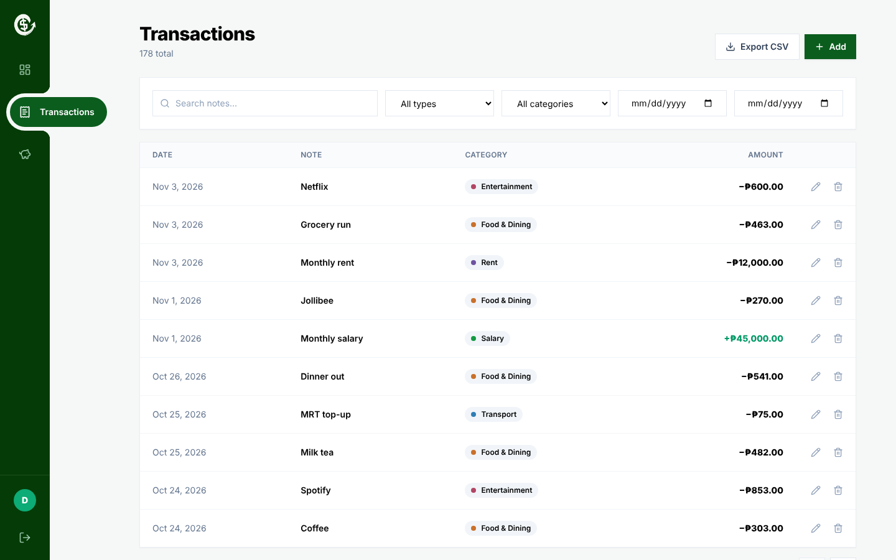

<div align="center">


# CashWell

**A personal finance tracker that shows you where your money goes.**

Log income and expenses, set monthly budgets, and watch a live dashboard update as you go.


[Live demo](#) · [Features](#features) · [Run it locally](SETUP.md) · [API](#api-overview)

</div>

---

## Screenshots

<p align="center">
  
</p>

<!--
| Dashboard | Budgets |
|---|---|
|  |  |

| Transactions | Landing page |
|---|---|
|  |  |
-->

## Try it in one click

No sign-up needed. Open the app and press **Try the demo account** to explore a dashboard filled with six months of sample data.

## Features

**Money tracking**
- Add, edit and delete transactions, each with a category, date and note
- Search by note, filter by type, category and date range, and paginate the results
- Export your transactions to CSV (the export respects your current filters)

**Budgets**
- Set a monthly limit for each expense category
- Progress bars change from green to amber to red as you approach the limit
- See how much is left, or how far over you are

**Dashboard**
- Net balance, income, expenses and savings rate for any month
- Change versus last month on income and expenses
- Income vs. expenses chart for the last 6 months
- Spending-by-category donut chart and recent activity

**Experience**
- Animated number counters, springy modal and progress bars
- Custom animated sidebar and floating navigation
- Fully responsive, with a bottom tab bar on mobile

**Accounts and security**
- Sign up and log in with JWT sessions and bcrypt-hashed passwords
- Every query is scoped to the logged-in user, so nobody can see anyone else's data

## How it works

```
React app (Vite)  ──Axios + JWT──▶  FastAPI  ──SQLAlchemy──▶  PostgreSQL (SQLite locally)
```

Frontend routes: `/` (landing), `/login`, `/about`, and the protected `/dashboard`, `/transactions`, `/budgets`, `/account`.

### Engineering decisions worth knowing about

1. **Data isolation.** Every query filters by `user_id`, and category ownership is re-checked on every write, so one user can't attach a transaction to another user's category.
2. **The server decides the type.** A transaction's `income` or `expense` type is copied from its category on the server and never trusted from the client.
3. **Aggregation in SQL.** Totals, per-category sums and the 6-month chart use `GROUP BY` + `SUM` in the database. Empty months are filled with zeros so the chart has no gaps.
4. **Date-range correctness.** Month queries use `date >= first_of_month AND date < first_of_next_month` (end exclusive), so no day is missed or counted twice.
5. **Debounced search.** The search box waits 350 ms after typing stops, so the API isn't called on every keystroke.

## API overview

Interactive docs are served at `/docs` when the backend is running.

| Method | Endpoint | Purpose |
|---|---|---|
| POST | `/api/auth/register` · `/login` · `/demo` | Create an account, log in, or open the demo account |
| GET | `/api/auth/me` | Current user |
| GET / POST / DELETE | `/api/categories` | Manage categories |
| GET / POST / PUT / DELETE | `/api/transactions` | CRUD with filters and pagination |
| GET | `/api/transactions/export` | CSV download |
| GET | `/api/budgets?month=YYYY-MM` | Budgets with the amount spent |
| PUT / DELETE | `/api/budgets/{category_id}` | Set (upsert) or remove a budget |
| GET | `/api/analytics/summary` · `/by-category` · `/monthly` | Dashboard data |


