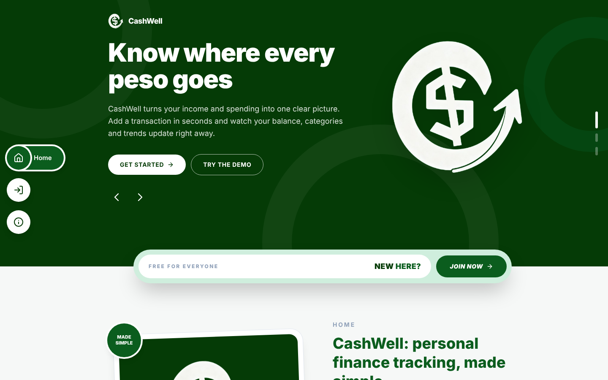
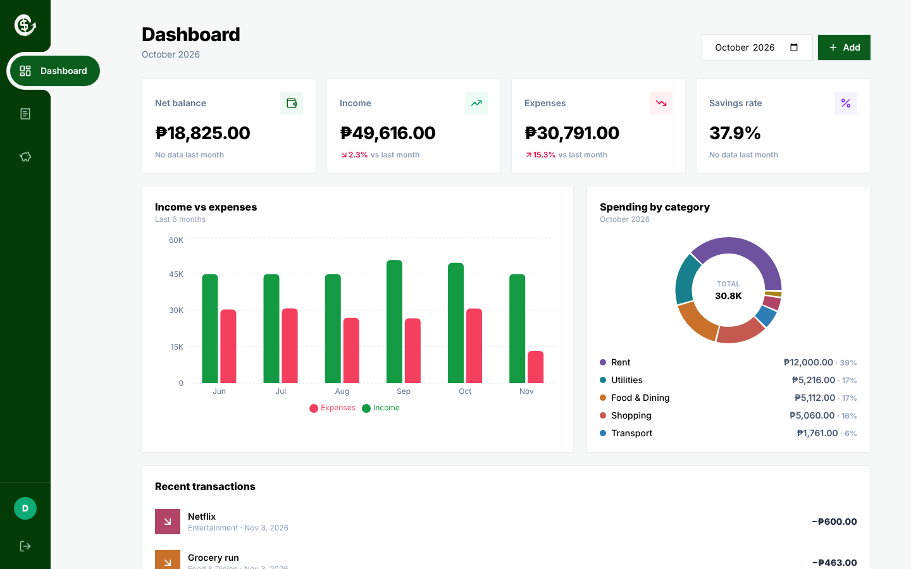
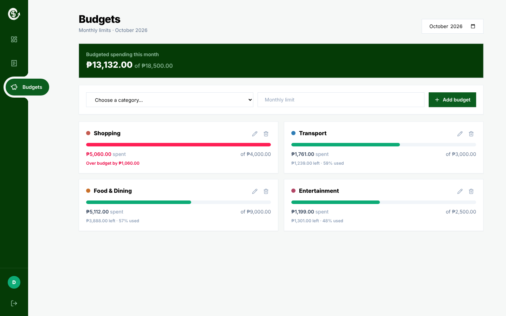

<div align="center">


# CashWell

*A personal finance tracker that shows you where your money goes.*


**[Live demo](https://cashwell-finance.vercel.app) | [Setup guide](SETUP.md) | [Features](#features)**

[](https://cashwell-finance.vercel.app)

</div>

Log income and expenses, set a monthly budget for each category, and watch a live dashboard update as you go.

> [!NOTE]
> CashWell is a full-stack portfolio project, built to learn how the whole stack fits together.

> [!TIP]
> Just want a look? Open the [live demo](https://cashwell-finance.vercel.app) and press **Try the demo**. One click, no sign-up, six months of sample data.

> [!CAUTION]
> The demo account is shared by everyone who opens it. Please don't enter real financial details.

## Features

- **Transactions.** Add, edit and delete them, then search, filter by type, category and date, and export to CSV.
- **Budgets.** A monthly limit per category, with progress bars that go from green to amber to red.
- **Dashboard.** Balance, income, expenses and savings rate for any month, plus a six-month chart and a spending donut.
- **Motion.** Animated counters, springy modals, and line-art icons that draw themselves.
- **Responsive.** A bottom tab bar in the app and a hamburger menu on the public pages.
- **Private by design.** JWT sessions, bcrypt passwords, and every query scoped to the logged-in user.

## Screenshots

| Dashboard | Budgets |
|---|---|
|  |  |

## Quick start

```bash
git clone https://github.com/RebEmnacin/CashWell.git

# terminal 1: backend (Python 3.10+)
cd CashWell/backend
python -m venv venv
source venv/bin/activate        # Windows: venv\Scripts\activate
pip install -r requirements.txt
cp .env.example .env
uvicorn app.main:app --reload

# terminal 2: frontend (Node 20.19+ or 22.12+)
cd CashWell/frontend
npm install
npm run dev
```

Open http://localhost:5173 and press **Try the demo**.

> [!IMPORTANT]
> The backend won't start without a `SECRET_KEY`. The example `.env` has a placeholder that is fine locally. Use a real one anywhere public. Everything else, including Postgres and deployment, is in the **[setup guide](SETUP.md)**.

## How it works

```
React app (Vite)  ──Axios + JWT──▶  FastAPI  ──SQLAlchemy──▶  PostgreSQL (SQLite locally)
```

The frontend and the API are separate apps, both deployed on Vercel, with Neon Postgres behind the API. Interactive API docs are served at `/docs` on a running backend.

## Engineering decisions

1. **Data isolation.** Every query filters by `user_id`, and category ownership is re-checked on every write.
2. **The server decides the type.** Income or expense comes from the category on the server, never from the client.
3. **Aggregation in SQL.** Totals and the six-month chart use `GROUP BY` and `SUM`, with empty months filled in.
4. **Date-range correctness.** Month queries use an exclusive end date, so no day is missed or counted twice.
5. **Debounced search.** It waits 350 ms after typing stops instead of calling the API on every keystroke.
