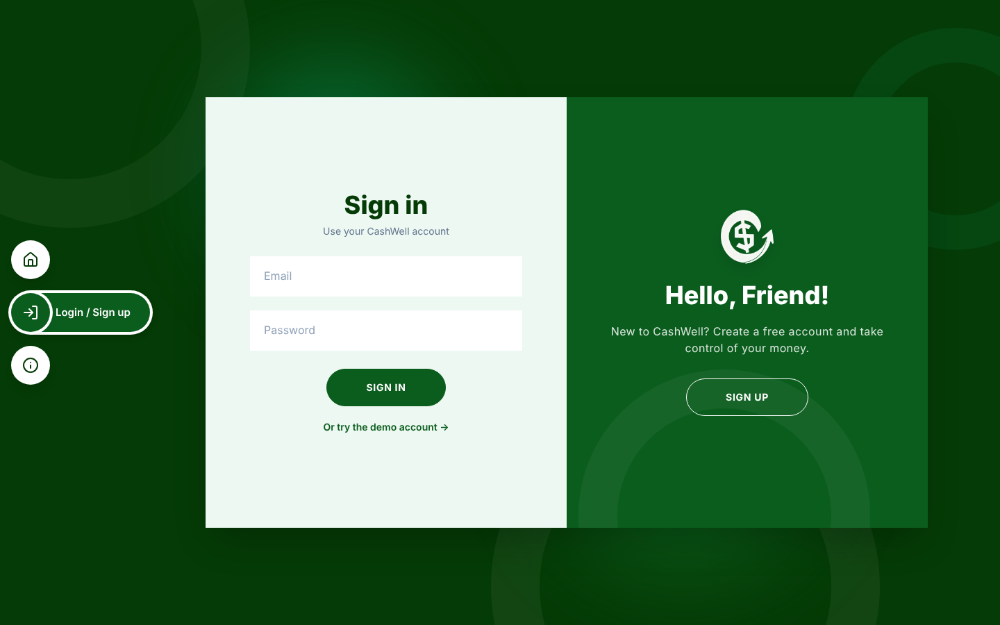

<div align="center">


# CashWell

*A personal finance tracker that shows you where your money goes.*


**[Live demo](https://cashwell-finance.vercel.app) | [Setup guide](SETUP.md) | [Features](#features) | [API](#api-overview)**

[](https://cashwell-finance.vercel.app)

</div>

**CashWell** lets you log income and expenses, set a monthly budget for each category, and watch a live dashboard update as you go. No spreadsheets, no guessing: just a clear picture of where every peso went.

> [!NOTE]
> CashWell is a full-stack portfolio project, built to learn how the whole stack fits together. The demo account is shared by everyone who opens it, so please don't enter real financial details.

## Table of contents

- [Quick start](#quick-start)
- [Features](#features)
- [Screenshots](#screenshots)
- [How it works](#how-it-works)
- [Status](#status)
- [Engineering decisions](#engineering-decisions)
- [Tech stack](#tech-stack)
- [Project structure](#project-structure)
- [API overview](#api-overview)
- [Documentation](#documentation)
- [Issues](#issues)

## Quick start

**Just want to look around?** Open the [live demo](https://cashwell-finance.vercel.app) and press **Try the demo**. It loads a dashboard filled with six months of sample data. One click, no sign-up.

**Want to run it yourself?** You need:

| Requirement | Version |
|---|---|
| Python | 3.10 or newer |
| Node.js | 20.19+ or 22.12+ |

Start the backend:

```bash
git clone https://github.com/RebEmnacin/CashWell.git
cd CashWell/backend
python -m venv venv
source venv/bin/activate        # Windows: venv\Scripts\activate
pip install -r requirements.txt
cp .env.example .env            # Windows: copy .env.example .env
uvicorn app.main:app --reload
```

Then, in a second terminal, start the frontend:

```bash
cd CashWell/frontend
npm install
npm run dev
```

Open http://localhost:5173 and press **Try the demo**.

The backend needs a `SECRET_KEY` to start. The example `.env` already has a placeholder that is fine for local use. For anything public, generate a real one. Environment variables, Postgres, deployment and troubleshooting are all in the **[setup guide](SETUP.md)**.

## Features

**Money tracking**

- 🧾 **Transactions.** Add, edit and delete them, each with a category, date and note.
- 🔎 **Search and filter.** Search by note, filter by type, category and date range, and page through the results.
- 📤 **CSV export.** Download your transactions. The export respects your current filters.

**Budgets**

- 🎯 **Monthly limits.** Set a limit for each expense category.
- 🚦 **Progress bars.** They shift from green to amber to red as you close in on the limit.
- 💸 **What's left.** See how much you have left, or how far over you are.

**Dashboard**

- 📊 **The month at a glance.** Net balance, income, expenses and savings rate for any month.
- 📈 **Change vs. last month.** See which way income and expenses are moving.
- 🍩 **Charts.** Income vs. expenses over six months, and a spending-by-category donut.
- 🕒 **Recent activity.** Your latest transactions, right there.

**Experience**

- ✨ **Motion.** Animated number counters and springy modals and progress bars.
- 🖋️ **Line-art icons that draw themselves** on the home and about pages.
- 📱 **Responsive.** A bottom tab bar inside the app and a hamburger menu on the public pages.
- 💱 **Pesos by default.** Currency and locale are set in one place, so switching is a one-line change.

**Accounts and security**

- 🔐 **Sign-up and login** with JWT sessions and bcrypt-hashed passwords.
- 🧱 **Your data stays yours.** Every query is scoped to the logged-in user.
- 🧪 **Demo account.** One click, with six months of realistic sample data.

## Screenshots

| Dashboard | Budgets |
|---|---|
|  |  |

| Transactions | Login and sign-up |
|---|---|
|  |  |

## How it works

```
React app (Vite)  ──Axios + JWT──▶  FastAPI  ──SQLAlchemy──▶  PostgreSQL (SQLite locally)
```

| Part | What it does |
|---|---|
| **Frontend** | A React and TypeScript single-page app. Public pages (`/`, `/login`, `/about`) and protected app pages (`/dashboard`, `/transactions`, `/budgets`, `/account`) live in one router. |
| **API** | A FastAPI app with automatic request validation, JWT auth and interactive docs at `/docs`. |
| **Database** | SQLAlchemy models on PostgreSQL. Locally it falls back to a SQLite file, so there's nothing to set up. |

In production the frontend and the API run as two Vercel projects, with a Neon Postgres database behind the API.

## Status

🟢 working &nbsp;&nbsp; 🟡 planned

| Area | Status | Notes |
|---|---|---|
| Sign-up, login and demo account | 🟢 | JWT sessions, bcrypt passwords |
| Transactions | 🟢 | Create, edit, delete, search, filter, paginate |
| CSV export | 🟢 | Respects filters |
| Budgets | 🟢 | Monthly limit per category, with progress bars |
| Dashboard and charts | 🟢 | Summary cards, 6-month chart, category donut |
| Category management screen | 🟡 | The API exists already, but there's no screen for it yet |
| Recurring transactions | 🟡 | Rent, subscriptions |
| Automated tests | 🟡 | Pytest for the API, Playwright end to end |
| Docker Compose and CI | 🟡 | API plus Postgres in one command |
| Dark mode, multiple currencies, receipt uploads | 🟡 | |

## Engineering decisions

A few things that took real thought:

1. **Data isolation.** Every query filters by `user_id`, and category ownership is re-checked on every write, so one user can't attach a transaction to another user's category.
2. **The server decides the type.** A transaction's `income` or `expense` type is copied from its category on the server and never trusted from the client.
3. **Aggregation in SQL.** Totals, per-category sums and the six-month chart use `GROUP BY` and `SUM` in the database. Empty months are filled with zeros so the chart has no gaps.
4. **Date-range correctness.** Month queries use `date >= first_of_month AND date < first_of_next_month` (end exclusive), so no day is missed or counted twice.
5. **Debounced search.** The search box waits 350 ms after typing stops, so the API isn't hit on every keystroke.

## Tech stack

| Layer | Tech | Why it's here |
|---|---|---|
| Frontend | React, TypeScript, Vite | A fast dev server, and TypeScript catches mistakes in money and date handling |
| Styling | Tailwind CSS v4 | Quick, consistent styling for cards, tables and forms |
| State | Zustand | A tiny store for the persisted login session |
| Routing | React Router | Public and protected pages in one router |
| HTTP | Axios | An interceptor adds the token and signs the user out on a 401 |
| Charts | Recharts | Simple chart components that plug straight into React |
| Animation | React Spring, Motion | Physics-based counters and modals, plus layout and scroll animation |
| Backend | FastAPI | Python, validation through Pydantic, and free API docs |
| Database | SQLAlchemy, PostgreSQL | Dashboard numbers are `GROUP BY` and `SUM` queries, which Postgres handles well |
| Local dev | SQLite | Run the whole project with zero database setup |

## Project structure

```
CashWell/
├── backend/app/
│   ├── main.py          # app, CORS, routers
│   ├── database.py      # engine and session (SQLite or Postgres)
│   ├── models.py        # users, categories, transactions, budgets
│   ├── schemas.py       # request and response validation
│   ├── security.py      # bcrypt, JWT, get_current_user
│   ├── seed.py          # default categories and demo data
│   └── routers/         # auth, categories, transactions, budgets, analytics
├── frontend/src/
│   ├── api/             # axios client and endpoint functions
│   ├── store/           # zustand auth store
│   ├── pages/           # Landing, Login, About, Dashboard, Transactions, Budgets, Account
│   ├── components/      # Layout, PublicLayout, TransactionModal, AnimatedNumber, LineIcon...
│   ├── hooks/           # useCategories
│   └── lib/             # currency and date formatting
├── docs/screenshots/    # images used in this README
└── SETUP.md             # the long setup, deployment and troubleshooting guide
```

## API overview

Interactive docs are served at `/docs` whenever the backend is running.

| Method | Endpoint | Purpose |
|---|---|---|
| POST | `/api/auth/register` · `/login` · `/demo` | Create an account, log in, or open the demo account |
| GET | `/api/auth/me` | Current user |
| GET / POST / DELETE | `/api/categories` | Manage categories |
| GET / POST / PUT / DELETE | `/api/transactions` | CRUD with filters and pagination |
| GET | `/api/transactions/export` | CSV download |
| GET | `/api/budgets?month=YYYY-MM` | Budgets with the amount spent |
| PUT / DELETE | `/api/budgets/{category_id}` | Set (upsert) or remove a budget |
| GET | `/api/analytics/summary` · `/by-category` · `/monthly` | Dashboard data |

## Documentation

- **[SETUP.md](SETUP.md)**: requirements, first-time setup, environment variables, Postgres, deployment, troubleshooting and a map of where things live.
- **`/docs`** on a running backend: the interactive API reference.

## Issues

Found a bug, or have an idea? [Open an issue](https://github.com/RebEmnacin/CashWell/issues). Rough edges are expected in a project like this, and feedback is welcome.

<div align="center">

**Like the project? Give it a ⭐**

</div>
